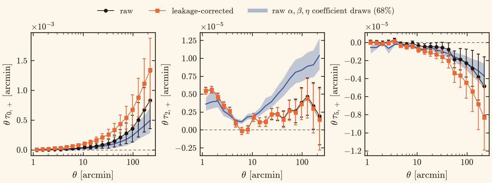
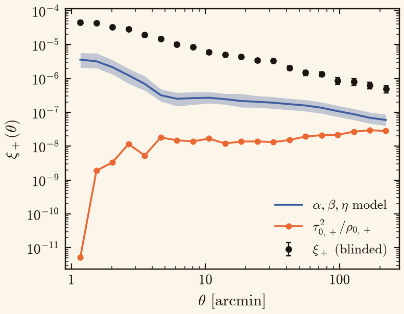
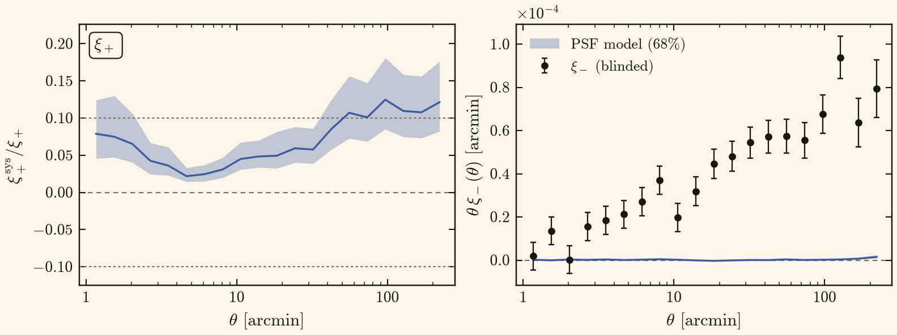
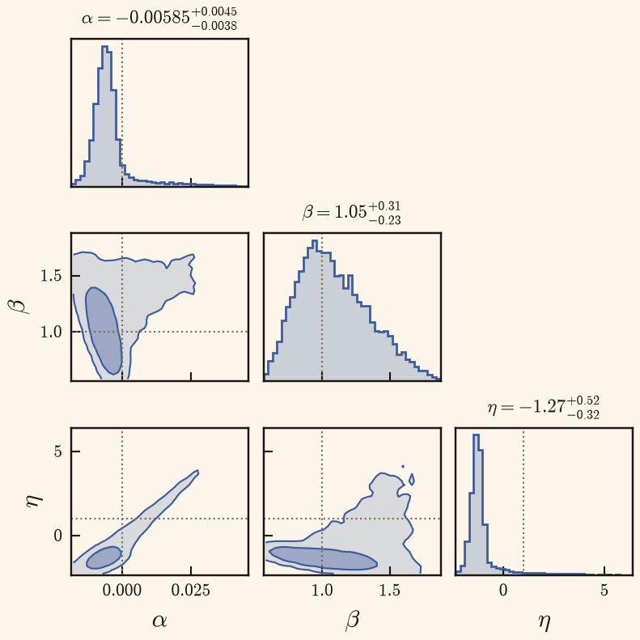

# θ·τ and blinded ξ± PSF comparisons

The dashboard keeps `psf_tau` unchanged and adds `psf_theta_tau` for θτ₀,+, θτ₂,+ and θτ₅,+ with θ in arcmin.
The new figure can overlay a separate, τ-only run of the object-wise leakage-corrected catalogue.
The band uses the **raw catalogue's** α–β–η coefficient-resampling draws (68%), scaled by θ; it is not a fit to the corrected catalogue.
Production `lsq` independently resamples ρ from its jackknife covariance and τ from its semi-analytical covariance, then solves generalized least squares for each draw.
These are not Bayesian posterior samples.
Each catalogue uses its own pair-weighted mean separations.
Error bars come from the theory τ covariance; points remain visible without bars where the diagonal variance is nonpositive.

`psf_xi_sys_comparison` now overlays the same reference version's cached, blinded ξ+ and its run covariance errors as black points.
The black points include cosmological signal, whereas the posterior band and τ₀,+²/ρ₀,+ estimate describe PSF contamination.
Their ratio to a blinded signal is a diagnostic, not a cosmological acceptance test.

`psf_xi_sys` retains the ξ+ ratio panel but shows signed θξ− data and the θξ−sys coefficient-resampling band in native units on the right, with analytic data errors and a zero line.
This avoids an unstable ratio at a ξ− zero crossing and removes the former ratio panel's silent clipping.
The data errors and model band remain separate; no numerator–denominator covariance or joint significance is inferred.

`psf_xi_sys` retains the ξ+ ratio panel, but replaces the ξ− ratio with signed θξ− data and analytic errors alongside the θξ−sys 68% posterior band.
The ξ− panel uses native units with θ in arcmin and a zero line; it never divides by the noisy data near a zero crossing and has no [−1, 1] clamp.
The ξ+ ratio band still propagates only the PSF-coefficient uncertainty while holding its blinded denominator fixed.

## Rendering

Use the normal dashboard build to prepare catalogue-level products, then pass the optional corrected run to its render stage:

```bash
python -m sp_validation.dashboard.render \
    --run-dir RUN --version SP_v2.0 \
    --maps-dir PRODUCTS --correlations-dir PRODUCTS \
    --corrected-tau-run CORRECTED_TAU_RUN \
    --out FIGURES
```

The corrected version defaults to `SP_v2.0_leak_corr`; use `--corrected-tau-version` to override it.
The corrected run needs only the non-tomographic ρ/τ SACC part and `th` τ covariance under `cosmo_val/rho_tau_stats/`.
It does not need an assembled cosmological SACC, corrected coefficient draws, or a completed validation DAG.
Omitting the corrected-run option draws raw τ alone.

## Full-area v2 examples

These examples use the 4,654.7 deg² full-area v2 catalogue, the raw run's existing coefficient draws and blinded ξ+, and a new corrected-τ measurement on the same area.



The corrected τ₀ is higher in all 20 bins, while τ₅ shifts downward in all 20; τ₂ changes much less.
Median corrected/raw ratios across the 20 bins are 2.424, 0.983 and 2.080 for τ₀, τ₂ and τ₅ respectively.
Ratios near zero crossings are unstable; these are descriptive summaries, not significance estimates.





At 2.025′ the blinded ξ− is only 0.0316 times its analytic standard error, while the model median is 0.0478 times that error.
The native-unit panel shows this scale without division through the near-zero data value.



These are coefficient-resampling draws, not a Bayesian posterior.
Each axis omits 0.3% of its marginal draws at each end.
The full sample ranges are α = [−0.0262, 0.0647], β = [0.442, 2.21] and η = [−3.33, 9.33]; the displayed η range is [−2.36, 6.41].
The truncated negative η tail is an axis choice, not a prior boundary.


