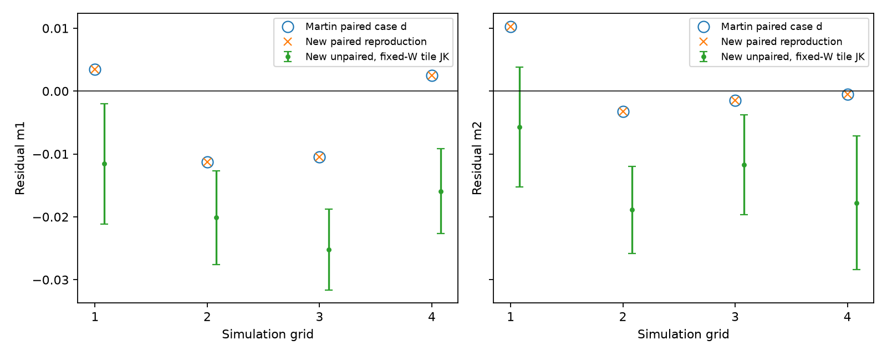
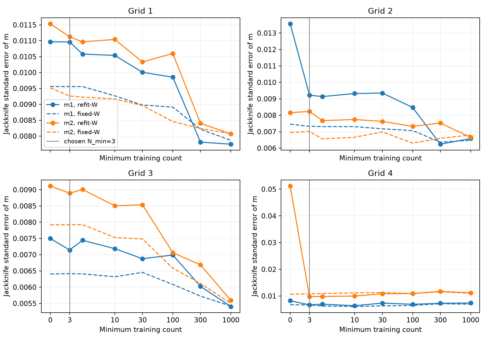
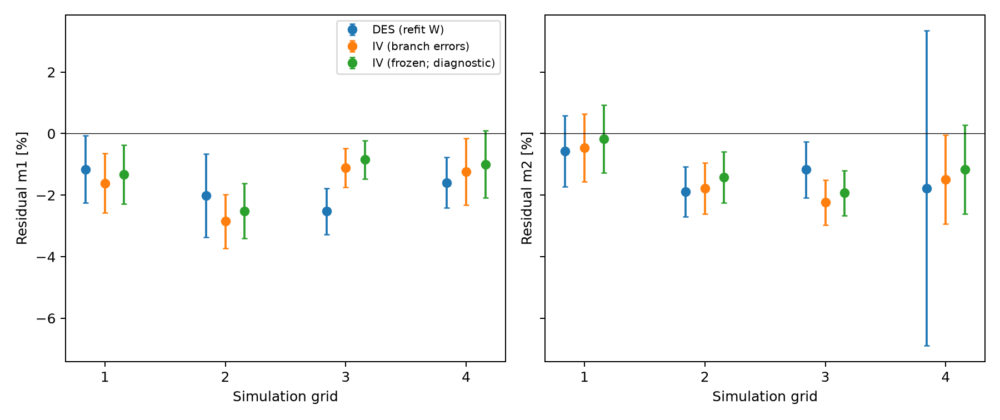
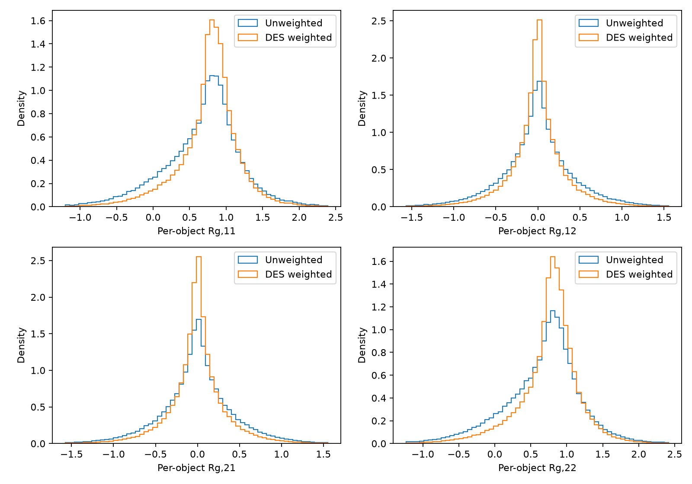
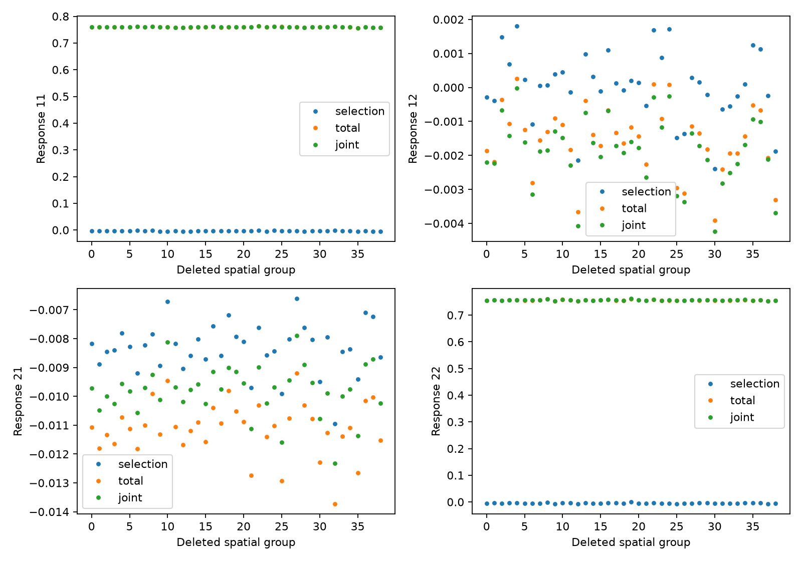
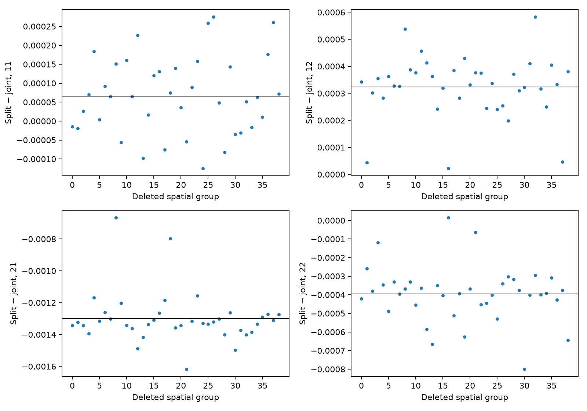
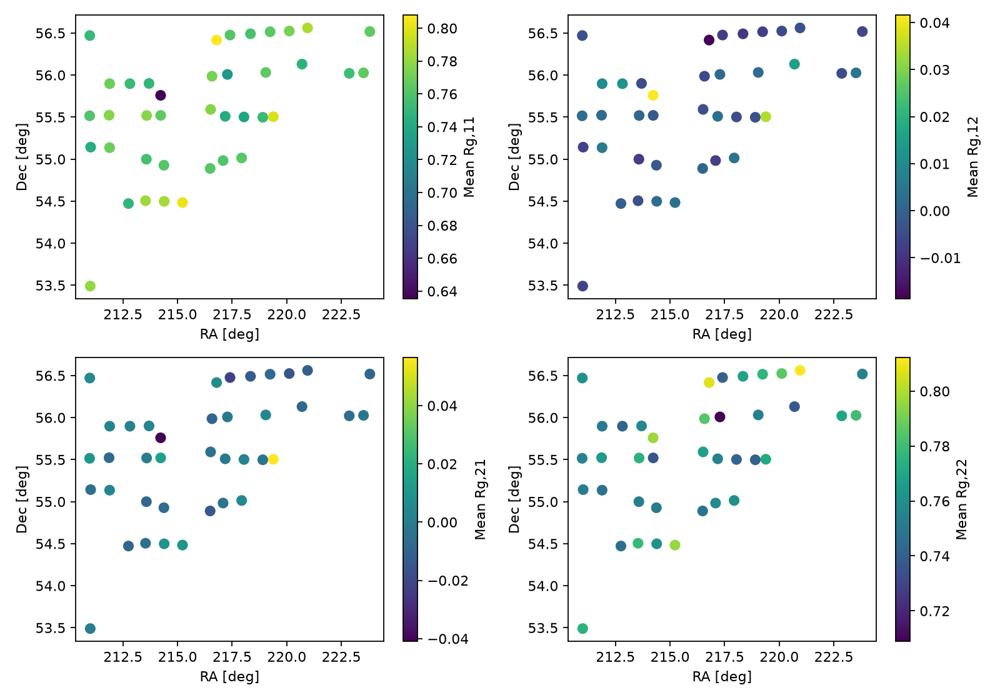
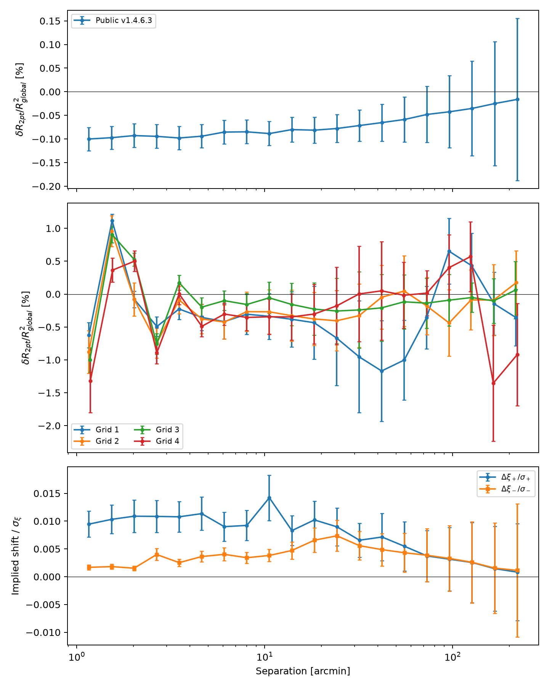

# DES case-d validation

These are observed results on Martin's four unblinded image-simulation grids.
Each grid contains five external-shear branches, with 39, 42, 32 and 35 shared tile labels on grids 1–4.
The injected shear is 0.025 from the existing manifest-derived m config; the metacal step is 0.01.
The parent revision and committed production implementation are recorded in each linked JSON file.
[Tests](tests.md): the final fast suite has **563 passes** and the **four known develop failures**.
All four production FITS-to-m/c checks reproduce the direct refit-W results to `atol=1e-13`.
[Previous fixed-W production comparison](production_comparison.json): all m/error differences were below 5×10⁻¹⁶.
The primary uncertainties below now refit W within each spatial deletion.

| Grid | Martin paired (m1, m2) | New paired (m1, m2) | New unpaired m1 | New unpaired m2 |
| --- | --- | --- | --- | --- |
| 1 | +0.003488, +0.010282 | +0.003488, +0.010282 | -0.011566 ± 0.010969 | -0.005699 ± 0.011536 |
| 2 | -0.011310, -0.003263 | -0.011310, -0.003263 | -0.020121 ± 0.013565 | -0.018895 ± 0.008158 |
| 3 | -0.010499, -0.001497 | -0.010499, -0.001497 | -0.025214 ± 0.007499 | -0.011697 ± 0.009114 |
| 4 | +0.002463, -0.000462 | +0.002463, -0.000462 | -0.015902 ± 0.008226 | -0.017761 ± 0.051197 |

The paired reproduction matches cuts (including FLAGS≤2), 20×20 table, right-closed interior cells, pair matching radius and symmetric pair weights.
Across all 20 external-shear products, max |R_new−R_Martin| = 7.04e-16, max relative W difference = 5.88e-15, and max paired-m difference = 4.22e-16.
The comparison uses `/n23data1/mkilbing/imsim_wdes_response/grid_*/des_d/results/m_bias_results.yaml`, specifically `weights.w_des`, not its unweighted top-level headline.

The production `ImageSimMBias` headline uses each external branch's full selected population, with its own weights and response.
Modern products refuse `pair_match: true`.
The saved `production_m` includes the full (m1,c1,m2,c2) shared-tile covariance and deleted estimates.
Its errors delete the same tile on both external branches, refit W on each retained no-shear sample, and re-evaluate all five branches before recalibrating R and the numerator.
These errors are not conditional fixed-response object-bootstrap errors.
The three-estimator figure holds the full-population responses fixed in every comparison.
Most of the paired–full gap is already present within the matched population when only the weight prescription changes.
Symmetric pair weights drop the branch-weight-change contribution from the numerator while case-d R retains it; the paired result is diagnostic, not consistent headline m.
Population restriction gives a smaller, mixed-sign correction.
Detection/blending selection may still contribute to the negative full-population m; this comparison does not isolate it.
Squaring IV errors changes exported w_iv but cannot change pure-DES W/R/m.
IV now uses measured errors on each artificial branch, not proxies or frozen no-shear errors.
No mean shear is subtracted from these constant-shear simulations.
These runs validate agreement with Martin's implementation, not a new fiducial residual-m calibration for blinded v2 data.



## Exact inverse-variance mode

**Observed:** ShapePipe's ngmix writer exports `sqrt(g_cov[0,0])` and `sqrt(g_cov[1,1])` on all five branches (`code/shapepipe/src/shapepipe/modules/ngmix_package/ngmix.py:758–759`).
The simulation `product/tiles/*/*/final_cat-*.fits` files retain all ten G_ERR columns.
The merged HDF5 and comprehensive FITS retain only the two no-shear errors.
The validation joins the missing columns by tile and NUMBER, checks the existing no-shear shape/error columns against the source, and applies each branch's own `1/(2 sigma_eps² + G1_ERR² + G2_ERR²)`.
Extraction retains all available branch errors, including with older params files; historical merged inputs without them remain usable for DES.
Modern IV refuses incomplete inputs rather than silently freezing weights.

| Grid | Exact IV m1 | Exact IV m2 | Exact − frozen m1 | Exact − frozen m2 |
| --- | ---: | ---: | ---: | ---: |
| 1 | −0.016086 ± 0.009589 | −0.004624 ± 0.011047 | −0.002788 ± 0.000276 | −0.002947 ± 0.000217 |
| 2 | −0.028511 ± 0.008738 | −0.017730 ± 0.008303 | −0.003371 ± 0.000566 | −0.003556 ± 0.000562 |
| 3 | −0.011107 ± 0.006234 | −0.022330 ± 0.007302 | −0.002624 ± 0.000259 | −0.003081 ± 0.000280 |
| 4 | −0.012291 ± 0.010830 | −0.014956 ± 0.014468 | −0.002338 ± 0.000356 | −0.003309 ± 0.000330 |

All errors delete identical parent tiles on both external branches and recalibrate the response (39, 42, 32, 35 groups).
Errors on differences use paired deletions, not errors added in quadrature.
[Full IV covariance and deleted estimates](iv_results.json) use the order (m1,c1,m2,c2).
Inverse-variance grid averages are m1 = −0.01612 ± 0.00414 and m2 = −0.01699 ± 0.00465; these component averages do not assume the two components are independent.

**Decision:** retain IV as a supported science mode with exact branch variances.
Freezing the errors omits a measured weight-response contribution and biases m upward by 0.23–0.36 percentage points relative to that estimator; it does not remove the remaining negative residual.
The common full-population estimator is used for both IV and DES.
**ShapePipe change:** retain all branch G_ERR columns in the final-catalogue merge allow-list; ngmix and tile-final writers already supply them.
No issue was filed.

## Fitted-weight uncertainty

**Decision:** refit-W is primary; fixed-W is a conditional comparison.
The DES table edges and all cuts stay fixed.
For each retained no-shear sample, refit its cell moments once, evaluate that table on all five artificial branches, and recompute both the normalized numerator and R.
FITS `R_JK` saves these calibrated deleted means as `c_g1,c_g2`; the production m estimator consumes them rather than applying a refitted R to fixed-W means.

| Grid | Fixed-W σ(m1) | Refit-W σ(m1) | Ratio | Fixed-W σ(m2) | Refit-W σ(m2) | Ratio |
| --- | ---: | ---: | ---: | ---: | ---: | ---: |
| 1 | 0.009560 | 0.010969 | 1.147 | 0.009517 | 0.011536 | 1.212 |
| 2 | 0.007458 | 0.013565 | 1.819 | 0.006948 | 0.008158 | 1.174 |
| 3 | 0.006405 | 0.007499 | 1.171 | 0.007920 | 0.009114 | 1.151 |
| 4 | 0.006715 | 0.008226 | 1.225 | 0.010664 | 0.051197 | 4.801 |

Every m error increases by more than 10%; fixing W understates this estimator's sampling uncertainty.
The grid-4 m2 increase is observed, not a numerical inversion failure: deletion of tile 275.282 gives m2 = −0.06974 and contributes 93.9% of the jackknife variance.
In the negative external-g2 sample, its most changed cell drops from three training objects to two, and W rises from 83.8 to 7730.4; the refitted response is finite but changes substantially.
This identifies a sparse-table sensitivity rather than evidence for a precisely calibrated grid-4 m2.
No clipping, smoothing or alternative table definition was introduced to hide that uncertainty.
The full-sample m values are unchanged.
[Fixed/refit covariance and all deletions](refit_w_results.json) preserve the evidence in (m1,c1,m2,c2) order.




## Paper I calibration provenance

**Observed:** Paper I, `analyses/shear_2d/unions_release/unions_shear_catalog_paper/draft_corrected.tex`, section “Residual multiplicative bias from image simulations” (lines 678–688), reports total m = −0.0572 ± 0.0047 and an additional realistic-placement blending contribution of approximately −0.02.
Its grid validation includes WCS-offset and FLAGS=0 selection effects; the total error was conservatively tripled to 0.0141 for Papers III/IV.
The text does not specify paired versus full-population m or its numerator weights.
Martin's retained `v2.0/image_sims/grids_1/results/m_bias_config.yaml` and `grids/results/m_bias_config.yaml` use `pair_match: true` and `w_cols: [none, w_iv]` (unweighted headline), but neither identifies itself as the run producing Paper I's number.
Thus those configs establish a paired/unweighted recipe, not verified provenance for that exact published estimate.

**Inferred comparison:** subtracting the approximately −0.02 blending contribution implies a Paper-I grid component near −0.0372, not −0.0572.
The new full-population DES grid averages are m1 = −0.01919 ± 0.00465 and m2 = −0.01357 ± 0.00535 with primary refit-W errors; they are about 1.8 and 2.4 percentage points less negative than that approximate component.
These inverse-variance combination errors assume independent grids; no significance for the historical/new difference is assigned.
This is a comparison of different pipeline/cut choices (the current grids include FLAGS≤2), not an isolated measurement of an estimator change.
No historical weight/pairing assignment beyond the evidence above is made, and no new fiducial residual m is adopted.

## Response distributions and spatial diagnostics






## Two-point response: stage 1 only

**Stage 1 is measured on the full public v1.4.6.3 release and all four unblinded grids, with shared-patch jackknife errors.**
The angular bins cover the science range 1–250 arcmin (20 logarithmic bins, matching the release ξ± reporting products).
Define r_i = (R_g11,i + R_g22,i)/2 and R_global = sum(w_i r_i)/sum(w_i), using the selected sample's science DES weights, not the historical IV-weighted FITS header.
The measured curve is f(θ) = δR_2pt/R_global² = sum_pairs(w_i w_j r_i r_j)/sum_pairs(w_i w_j)/R_global² − 1.
Public selection is the released cut catalogue (61,378,891 objects); grid selection is the current calibration's no-external-shear branch.
Thus selection and weight *values* affect both the pair and global averages, including their spatial weighting.

Delete one identical spatial patch from both terms, recompute their ratio, then use (K−1)/K covariance across deletions.
This propagates pair/global covariance rather than attaching only pair-product errors.
These stage-1 errors condition on the supplied science weights; the calibration m uncertainty from refitting W is measured separately above.
The release uses its existing 100 sky patches; the simulations use shared tile labels (39, 42, 32, 35).
Synthetic constant-r and spatially varying-r tests compare the curve and every deletion against explicit pair sums.



| Sample | Max absolute f(θ) | Spatial groups |
| --- | ---: | ---: |
| Public v1.4.6.3 | 0.1000% | 100 |
| Grid 1 | 1.1692% | 39 |
| Grid 2 | 0.9568% | 42 |
| Grid 3 | 1.0001% | 32 |
| Grid 4 | 1.3539% | 35 |

For the public release, representative curve values are −0.1000 ± 0.0246% at 1.16 arcmin, −0.0886 ± 0.0254% at 10.58 arcmin, −0.0587 ± 0.0478% at 55.44 arcmin and −0.0163 ± 0.1715% at 220.33 arcmin.
Every bin, its error, the full covariance and the delete-one curves are in [stage1_results.json](stage1_results.json) and `stage1_{public,1,2,3,4}.npz`.
The full-release measurement took 1592.0 s and 39.9 GiB peak RSS on four allocated cores.
The grids use exact angular binning (`bin_slop=0`); the full release uses `bin_slop=0.05`.
Halving the release slop from 0.1 to 0.05 changes f by at most 0.00623 percentage points (0.254 of its jackknife error).
Across the grids, exact-versus-0.1 binning differences reach 0.0386 percentage points and 0.206 times the jackknife error; those maxima need not occur in the same bin.
The [per-sample numerical comparison](stage1_precision.json) records both the absolute and error-normalized maxima; these are numerical comparisons, not an added stochastic error term.
The original catalogues stay in place; only response summaries are committed.

**Conditional interpretation:** replacing the scalar shear-response product by this pair response multiplies globally calibrated ξ± by 1/(1+f), giving fractional shift −f/(1+f).
On the release this is +0.0163–0.1001%; using the existing public ξ± measurements and their jackknife statistical errors gives a maximum |Δξ+/σ+| = 0.0142 and |Δξ−/σ−| = 0.0074 per bin.
The lower panel propagates the response-curve error through that mapping, holding those existing ξ values/errors fixed.
These are conditional shear-response shifts, not a measured total-response correction or a joint cosmological significance.

**Stage 1 leaves out** selection/weight *derivatives*, detection response, anisotropic tensor mixing and the Appendix-A mixed finite differences of the normalized pair estimator.
Per-object R_g cannot supply those derivatives; no per-object R_sel is manufactured.
No total-response adequacy verdict or tolerance is asserted.
#23 remains **Refs**, with stage 2 a separate later investigation; no blinded v2 signal was measured.
The earlier all-16-element, eight-bin grid-1 diagnostic remains available as [pair_response.png](pair_response.png), but does not replace this scale-dependent curve with errors.

## Reproduction

On allocation 1037389, from this checkout:

```bash
TMPDIR=/n17data/cdaley/tmp MPLCONFIGDIR=/n17data/cdaley/tmp/mpl \
srun --jobid=1037389 -n 1 -c 4 apptainer exec --bind /automnt,/n17data,/n23data1 \
  --env PYTHONPATH=$PWD/src ~/.cache/sp_validation/sp_validation.sif \
  python scripts/validation/validate_response.py --grid 1 \
  --output /n17data/cdaley/scratch/response-pr/grid_1
```

Repeat for grids 2–4, then run `scripts/validation/summarize_response.py` on a compute node.
For round 2, use allocation 1037411 and output root `/n17data/cdaley/scratch/response-pr/round2/`.
Run `scripts/validation/round2_weights.py --grid N --output <root>` for the exact-IV and fixed/refit-W measurements.
Add `--production-check` to round-trip the refit-W means through FITS and `ImageSimMBias`.
Run `scripts/validation/round2_pairs.py --sample public --output <root>` and repeat with `--sample 1`, `2`, `3`, `4` for the stage-1 curves.
Run `scripts/validation/summarize_round2.py <root> docs/validation/response` for the comparison figures.
Refit-W covariance is primary because its measured m errors exceed fixed-W by 15–380%.
