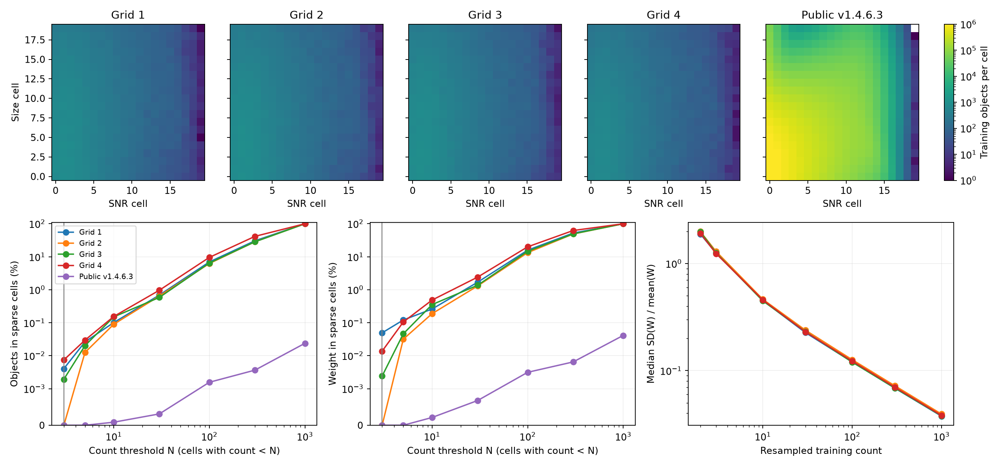

# DES case-d validation

These are observed self-built-table diagnostics on Martin's four unblinded image-simulation grids.
Round 4 below tests independent training; self-built weights are no longer the image-sim production default.
Each grid contains five external-shear branches, with 39, 42, 32 and 35 shared tile labels on grids 1–4.
The injected shear is 0.025 from the existing manifest-derived m config; the metacal step is 0.01.
The earlier validation JSONs record their parent revisions; sparse-cell pooling was introduced in commit `354d0898`.
[Tests](tests.md) record the fast suite and production FITS-to-m/c checks.
The primary DES table uses the minimum-count rule below with **N_min = 3**.
[Previous fixed-W production comparison](production_comparison.json): all m/error differences were below 5×10⁻¹⁶.
The primary uncertainties below now refit W within each spatial deletion.

| Grid | Full-population m1 ± refit-W error | Full-population m2 ± refit-W error |
| --- | --- | --- |
| 1 | -0.011818 ± 0.010959 | -0.004920 ± 0.011124 |
| 2 | -0.022088 ± 0.009219 | -0.018779 ± 0.008230 |
| 3 | -0.024994 ± 0.007144 | -0.011730 ± 0.008891 |
| 4 | -0.015556 ± 0.006673 | -0.018473 ± 0.009761 |

With `des_min_count: 0`, the paired reproduction matches cuts (including FLAGS≤2), 20×20 table, right-closed interior cells, pair matching radius and symmetric pair weights.
Across all 20 external-shear products, max |R_new−R_Martin| = 7.04e-16, max relative W difference = 5.88e-15, and max paired-m difference = 4.22e-16.
The comparison uses `/n23data1/mkilbing/imsim_wdes_response/grid_*/des_d/results/m_bias_results.yaml`, specifically `weights.w_des`, not its unweighted top-level headline.

The production `ImageSimMBias` headline uses each external branch's full selected population, with its own weights and response.
Modern products refuse `pair_match: true`.
The saved `production_m` includes the full (m1,c1,m2,c2) shared-tile covariance and deleted estimates.
Its errors delete the same tile on both external branches, refit W on each retained no-shear sample, and re-evaluate all five branches before recalibrating R and the numerator.
These errors are not conditional fixed-response object-bootstrap errors.
The three-estimator figure holds the full-population responses fixed in every comparison.
Most of the paired–full gap is already present within the matched population when only the weight prescription changes.
Symmetric pair weights drop the branch-weight-change contribution from the numerator while case-d R retains it; the paired result is diagnostic, not consistent headline m.
Population restriction gives a smaller, mixed-sign correction.
Detection/blending selection may still contribute to the negative full-population m; this comparison does not isolate it.
Squaring IV errors changes exported w_iv but cannot change pure-DES W/R/m.
IV now uses measured errors on each artificial branch, not proxies or frozen no-shear errors.
No mean shear is subtracted from these constant-shear simulations.
These runs validate agreement with Martin's implementation, not a new fiducial residual-m calibration for blinded v2 data.


## Exact inverse-variance mode

**Observed:** ShapePipe's ngmix writer exports `sqrt(g_cov[0,0])` and `sqrt(g_cov[1,1])` on all five branches (`code/shapepipe/src/shapepipe/modules/ngmix_package/ngmix.py:758–759`).
The simulation `product/tiles/*/*/final_cat-*.fits` files retain all ten G_ERR columns.
The merged HDF5 and comprehensive FITS retain only the two no-shear errors.
The validation joins the missing columns by tile and NUMBER, checks the existing no-shear shape/error columns against the source, and applies each branch's own `1/(2 sigma_eps² + G1_ERR² + G2_ERR²)`.
Extraction retains all available branch errors, including with older params files; historical merged inputs without them remain usable for DES.
Modern IV refuses incomplete inputs rather than silently freezing weights.

| Grid | Exact IV m1 | Exact IV m2 | Exact − frozen m1 | Exact − frozen m2 |
| --- | ---: | ---: | ---: | ---: |
| 1 | −0.016086 ± 0.009589 | −0.004624 ± 0.011047 | −0.002788 ± 0.000276 | −0.002947 ± 0.000217 |
| 2 | −0.028511 ± 0.008738 | −0.017730 ± 0.008303 | −0.003371 ± 0.000566 | −0.003556 ± 0.000562 |
| 3 | −0.011107 ± 0.006234 | −0.022330 ± 0.007302 | −0.002624 ± 0.000259 | −0.003081 ± 0.000280 |
| 4 | −0.012291 ± 0.010830 | −0.014956 ± 0.014468 | −0.002338 ± 0.000356 | −0.003309 ± 0.000330 |

All errors delete identical parent tiles on both external branches and recalibrate the response (39, 42, 32, 35 groups).
Errors on differences use paired deletions, not errors added in quadrature.
[Full IV covariance and deleted estimates](iv_results.json) use the order (m1,c1,m2,c2).
Inverse-variance grid averages are m1 = −0.01612 ± 0.00414 and m2 = −0.01699 ± 0.00465; these component averages do not assume the two components are independent.

**Decision:** retain IV as a supported science mode with exact branch variances.
Freezing the errors omits a measured weight-response contribution and biases m upward by 0.23–0.36 percentage points relative to that estimator; it does not remove the remaining negative residual.
The common full-population estimator is used for both IV and DES.
**ShapePipe change:** retain all branch G_ERR columns in the final-catalogue merge allow-list; ngmix and tile-final writers already supply them.
No issue was filed.

## Sparse cells and fitted-weight uncertainty

**Decision:** use `des_min_count: 3` and make refit-W errors primary.
A cell with at least three valid no-shear training objects retains Martin's W = mean(trace R/2)² / mean(|e|²/2), exactly.
For a cell below that threshold, grow a concentric square in the fixed logarithmic SNR × size cell grid, one cell-index radius at a time, clipping at the table boundaries.
Use the first square reaching N_min and pool its response sums, ellipticity second-moment sums and counts; do not average its cell weights.
If the entire training sample has fewer than N_min objects, use its pooled moments.
This is the smallest neighbourhood within that deterministic square-window family, not a search over arbitrary rectangles.
The same fitted table supplies every artificial branch, including newly occupied cells.
Every spatial deletion repeats the training-count test and pooling on its retained no-shear population, keeping edges and cuts fixed.
Original unmerged training counts remain in `W_COUNT`; FITS headers record `DESNMIN` and `DESMERGE`.
`des_min_count: 0` preserves the exact unregularized comparison, and historical legacy calibration is unchanged.

The [complete ladder](sparse_ladder.md) reports m, fixed/refit errors, occupancy shares at every threshold, public-release affected fractions and sampling noise.
It covers N_min = 0, 3, 5, 10, 30, 100, 300, 1000 on every grid; full covariance and deletions are in `sparse_grid_{1,2,3,4}.json`, ordered (m1,c1,m2,c2).
All four N_min=0 baselines reproduce the round-2 values, errors, covariance and deletions within 1e-13.

**The first stable error plateau is N_min = 3–10.**
Across all eight m errors, changing 3 to either 5 or 10 changes the refit-W error by at most **6.78%**.
N_min≤2 cannot fix the observed two-object deletion cell; 3 is the smallest integer that can.
Grid-4 σ(m2) falls from 0.051197 to **0.009761**; its largest single deletion now contributes **13.8%**, rather than 93.9%, of the variance.
For tile 275.282, the offending cell's W goes from 83.8 to **27.2** after deletion, rather than to 7730.4.
N_min=3 leaves that full-sample three-object cell unchanged.
Higher thresholds increasingly alter the estimator rather than just removing the one-/two-object tail: at N_min=10 grid-4 m1 shifts by 0.66σ, and at 100 grid-3 m1 shifts by 0.86σ.
Those larger changes are unnecessary on the observed plateau.
No hard W cap or shrinkage parameter is added.
This is an empirical stability decision for these grids, not a guarantee that every three-object W is precise.

| Grid | Δm1 (chosen − N_min=0) | Δm2 | Δm1 / chosen σ(m1) | Δm2 / chosen σ(m2) |
| --- | ---: | ---: | ---: | ---: |
| 1 | -0.000253 | +0.000779 | -0.023 | +0.070 |
| 2 | -0.001967 | +0.000115 | -0.213 | +0.014 |
| 3 | +0.000220 | -0.000033 | +0.031 | -0.004 |
| 4 | +0.000346 | -0.000712 | +0.052 | -0.073 |

The largest m shift is **0.213 of its primary error**; the other seven are below 0.073σ.
[Paired-deletion errors on these shifts](sparse_shifts.json) retain the covariance with the unregularized estimator.

### Occupancy and weight noise

The 20×20 tables have 400 occupied cells on every no-external-shear grid and 399 on the public release.
The fixed log edges are SNR 10–500 and T/T_PSF 0.707–3; release training uses all 61,378,891 released cut objects, without reselecting or copying the catalogue.
Counts below are valid training counts before any merging; weight shares use the reconstructed N_min=0 table.
The JSON also records each of the four externally sheared training samples per grid, since those train the m measurement.

| Sample | Training objects | Min / median / max occupied-cell count | Objects in cells below 3 | Their weight share (%) |
| --- | ---: | --- | ---: | ---: |
| Grid 1 | 98,608 | 1 / 159.5 / 888 | 4 | 0.0494 |
| Grid 2 | 103,131 | 3 / 172.5 / 909 | 0 | 0 |
| Grid 3 | 103,517 | 2 / 170.5 / 933 | 2 | 0.0024 |
| Grid 4 | 80,615 | 2 / 130 / 700 | 6 | 0.0137 |
| Public v1.4.6.3 | 61,378,891 | 1 / 63,814 / 1,308,682 | 3 | 0.00000498 |

On the release the chosen rule affects three objects, **0.00000489%** of the population, carrying **0.00000498%** of reconstructed DES weight or **0.00000332%** of the actual released weight.
Its three under-threshold cells include one empty cell, whose evaluation weight can change without affecting a released object.
At N_min=10, 30, 100, 300 the affected release populations are 54, 193, 966, 2253 objects; their reconstructed weight shares are 0.000217%, 0.000680%, 0.003152%, 0.006512%.

Within each grid's cells having at least 100 parent objects, 300 bootstrap draws at each resampled count measure SD(W)/mean(W), with fixed seed 425 and equal weighting of cells.
The median across cells is **189–199% at count 2**, **124–130% at 3**, **45–46% at 10**, **23–24% at 30**, **12–13% at 100**, **6.9–7.2% at 300**, and **3.8–3.9% at 1000**.
The large-count scaling is approximately N^(-1/2); at very small counts the nonlinear ratio has a much larger tail.
Thus individual sparse-cell W estimates remain noisy even on the selected plateau; the decision uses the measured stability of m and its refitted uncertainty, not a claim of small per-cell W error.

Refit-W remains primary because it propagates the fitted-table uncertainty and its covariance with response and numerator, not because it must exceed fixed-W in every component.
For each deletion, refit once and recompute both the normalized numerator and R on every branch.
FITS `R_JK` saves the calibrated deleted means as `c_g1,c_g2`; the production m estimator consumes them rather than applying a refitted R to fixed-W means.
The [round-2 unregularized covariance](refit_w_results.json) remains as the sparse-cell failure comparison.





## Independent training and self-weighting (round 4)

**Observed toy result:** fitting W from the galaxies it weights produces m ≈ −1/N_cell; independent training removes that effect in this controlled Gaussian model.
The toy has unit response, Gaussian intrinsic ellipticity with per-component σ=0.25, 400 equally occupied cells and no PSF, noise bias, selection or cell migration.
Each of 200 trials uses identical intrinsic shapes at external shears ±0.025; the independent case uses a second intrinsic-shape draw for training.
Metacal shifts do not change cell membership, so case-d split response is exactly the identity.
Errors below are Monte Carlo standard errors, not galaxy errors or spatial jackknifes.

| N per cell | Self-built m | Independent-table m |
| --- | ---: | ---: |
| 3 | −0.33216 ± 0.00192 | +0.00357 ± 0.00386 |
| 10 | −0.09850 ± 0.00045 | +0.00056 ± 0.00045 |
| 100 | −0.009870 ± 0.000048 | −0.000008 ± 0.000036 |
| 1000 | −0.0009991 ± 0.0000052 | −0.0000036 ± 0.0000035 |

[All toy counts and Monte Carlo errors](self_weight_toy.json) include N=30 and 300.
A one-cell catalogue would cancel its common weight exactly; multiple independently fitted cells are essential to this test.
**Interpretation:** the anticorrelation between each cell's mean shape and its estimated inverse second moment is sufficient to generate a negative finite-sample bias without any physical measurement bias.
The effect is not proportional to the relative scatter of W itself: that scatter scales as N^(-1/2), while this toy's mean bias scales as N^(-1).

**Observed grid comparison:** all entries below are m × 10³, with shared-tile jackknife errors, N_min=3 and unchanged cuts, bin edges and case-d response.
(a) fits each external branch's own table; (b) trains on the other three grids; (c) pools all four.
For (b)/(c), training pools the same external-shear label across grids and uses only each catalogue's no-artificial-shear metacal branch.
No +/− external-shear averaging is introduced.
Errors refit the target grid's retained training population in (a)/(c); the other grids are held fixed.
(b) uses fixed-W errors because its training galaxies are external to the target.
These errors are conditional on the external training populations, not a joint resampling of all four grids.
The (a) values and every deleted estimate exactly reproduce the round-3 N_min=3 baseline.

| Grid | Component | (a) Self | (b) Other three | (c) Pooled four | (d) Release |
| --- | --- | ---: | ---: | ---: | --- |
| 1 | m1 | -11.82 ± 10.96 | -4.48 ± 7.88 | -6.21 ± 8.30 | Not verified |
| 1 | m2 | -4.92 ± 11.12 | -7.42 ± 9.14 | -6.50 ± 8.90 | Not verified |
| 2 | m1 | -22.09 ± 9.22 | -18.78 ± 6.34 | -19.92 ± 6.44 | Not verified |
| 2 | m2 | -18.78 ± 8.23 | -8.83 ± 6.86 | -11.28 ± 6.77 | Not verified |
| 3 | m1 | -24.99 ± 7.14 | -12.88 ± 5.31 | -16.44 ± 5.21 | Not verified |
| 3 | m2 | -11.73 ± 8.89 | -9.22 ± 6.66 | -10.29 ± 6.59 | Not verified |
| 4 | m1 | -15.56 ± 6.67 | -1.89 ± 8.03 | -4.36 ± 6.85 | Not verified |
| 4 | m2 | -18.47 ± 9.76 | -4.53 ± 10.72 | -8.13 ± 10.24 | Not verified |

Paired differences below subtract the identical tile deletion in (b) from the refitted deletion in (a), retaining their covariance; units are again 10⁻³.

| Grid | Δm1 (a−b) | Δm2 (a−b) |
| --- | ---: | ---: |
| 1 | -7.34 ± 6.57 | +2.50 ± 8.22 |
| 2 | -3.31 ± 7.44 | -9.95 ± 4.77 |
| 3 | -12.11 ± 6.58 | -2.51 ± 7.53 |
| 4 | -13.67 ± 8.11 | -13.94 ± 6.55 |

[Grid 1](independent_grid_1.json), [2](independent_grid_2.json), [3](independent_grid_3.json), [4](independent_grid_4.json) save (m1,c1,m2,c2), all covariance matrices, labels and deleted estimates.
Seven of eight self-minus-independent shifts are negative; pooling gives an intermediate value in all eight comparisons.
Individual shifts are mostly only 0.3–2.1 times their paired error.
No combined significance is assigned: leave-one-grid-out training populations overlap, and these conditional errors do not include cross-grid training covariance.
**Inference:** the toy confirms the proposed mechanism, and the grids support a contribution from it, but these measurements neither attribute all the negative m to self-weighting nor isolate its exact fraction from changes in the noisy table realization.
In particular grid-2 m1 remains −0.01878 with independent training.

**Release compatibility:** case (d) was not measured.
The public v1.4.6.3 FITS contains released w_des values but no saved W_DES/W_EDGES product.
Using released snr and NGMIX_T_NOSHEAR/NGMIX_Tpsf_NOSHEAR with the simulations' 20×20 log edges (10–500, 0.707–3), **379 cells are nonconstant in released w_des**, with maximum within-cell relative range 0.99962.
Thus those coordinates/edges do not recover the actual release table; a moment-reconstructed table would be a different estimator.
The release has no NGMIX_T_PSF_RECONV_NOSHEAR column with which to verify the alternative naming directly.
[Compatibility scan](self_weight_public_compatibility.json) records this check over all 61,378,891 released objects.
No reconstructed public table is substituted for (d).

## Paper I calibration provenance

**Observed:** Paper I, `analyses/shear_2d/unions_release/unions_shear_catalog_paper/draft_corrected.tex`, section “Residual multiplicative bias from image simulations” (lines 678–688), reports total m = −0.0572 ± 0.0047 and an additional realistic-placement blending contribution of approximately −0.02.
Its grid validation includes WCS-offset and FLAGS=0 selection effects; the total error was conservatively tripled to 0.0141 for Papers III/IV.
The text does not specify paired versus full-population m or its numerator weights.
Martin's retained `v2.0/image_sims/grids_1/results/m_bias_config.yaml` and `grids/results/m_bias_config.yaml` use `pair_match: true` and `w_cols: [none, w_iv]` (unweighted headline), but neither identifies itself as the run producing Paper I's number.
Thus those configs establish a paired/unweighted recipe, not verified provenance for that exact published estimate.

**Inferred comparison:** subtracting the approximately −0.02 blending contribution implies a Paper-I grid component near −0.0372, not −0.0572.
The minimum-count full-population DES grid averages are m1 = −0.01927 ± 0.00401 and m2 = −0.01434 ± 0.00466 with primary refit-W errors; they are about 1.8 and 2.3 percentage points less negative than that approximate component.
These inverse-variance combination errors assume independent grids; no significance for the historical/new difference is assigned.
This is a comparison of different pipeline/cut choices (the current grids include FLAGS≤2), not an isolated measurement of an estimator change.
No historical weight/pairing assignment beyond the evidence above is made, and no new fiducial residual m is adopted.

## Response distributions and spatial diagnostics


## Two-point response: stage 1 only

**Stage 1 is measured on the full public v1.4.6.3 release and all four unblinded grids, with shared-patch jackknife errors.**
The grid curves below retain their round-2 N_min=0 weights; the public curve uses the actual released weights, not a recalibrated catalogue.
The angular bins cover the science range 1–250 arcmin (20 logarithmic bins, matching the release ξ± reporting products).
Define r_i = (R_g11,i + R_g22,i)/2 and R_global = sum(w_i r_i)/sum(w_i), using the selected sample's science DES weights, not the historical IV-weighted FITS header.
The measured curve is f(θ) = δR_2pt/R_global² = sum_pairs(w_i w_j r_i r_j)/sum_pairs(w_i w_j)/R_global² − 1.
Public selection is the released cut catalogue (61,378,891 objects); grid selection is the current calibration's no-external-shear branch.
Thus selection and weight *values* affect both the pair and global averages, including their spatial weighting.

Delete one identical spatial patch from both terms, recompute their ratio, then use (K−1)/K covariance across deletions.
This propagates pair/global covariance rather than attaching only pair-product errors.
These stage-1 errors condition on the supplied science weights; the calibration m uncertainty from refitting W is measured separately above.
The release uses its existing 100 sky patches; the simulations use shared tile labels (39, 42, 32, 35).
Synthetic constant-r and spatially varying-r tests compare the curve and every deletion against explicit pair sums.


| Sample | Max absolute f(θ) | Spatial groups |
| --- | ---: | ---: |
| Public v1.4.6.3 | 0.1000% | 100 |
| Grid 1 | 1.1692% | 39 |
| Grid 2 | 0.9568% | 42 |
| Grid 3 | 1.0001% | 32 |
| Grid 4 | 1.3539% | 35 |

For the public release, representative curve values are −0.1000 ± 0.0246% at 1.16 arcmin, −0.0886 ± 0.0254% at 10.58 arcmin, −0.0587 ± 0.0478% at 55.44 arcmin and −0.0163 ± 0.1715% at 220.33 arcmin.
Every bin, its error, the full covariance and the delete-one curves are in [stage1_results.json](stage1_results.json) and `stage1_{public,1,2,3,4}.npz`.
The full-release measurement took 1592.0 s and 39.9 GiB peak RSS on four allocated cores.
The grids use exact angular binning (`bin_slop=0`); the full release uses `bin_slop=0.05`.
Halving the release slop from 0.1 to 0.05 changes f by at most 0.00623 percentage points (0.254 of its jackknife error).
Across the grids, exact-versus-0.1 binning differences reach 0.0386 percentage points and 0.206 times the jackknife error; those maxima need not occur in the same bin.
The [per-sample numerical comparison](stage1_precision.json) records both the absolute and error-normalized maxima; these are numerical comparisons, not an added stochastic error term.
The original catalogues stay in place; only response summaries are committed.

**Conditional interpretation:** replacing the scalar shear-response product by this pair response multiplies globally calibrated ξ± by 1/(1+f), giving fractional shift −f/(1+f).
On the release this is +0.0163–0.1001%; using the existing public ξ± measurements and their jackknife statistical errors gives a maximum |Δξ+/σ+| = 0.0142 and |Δξ−/σ−| = 0.0074 per bin.
The lower panel propagates the response-curve error through that mapping, holding those existing ξ values/errors fixed.
These are conditional shear-response shifts, not a measured total-response correction or a joint cosmological significance.

**Stage 1 leaves out** selection/weight *derivatives*, detection response, anisotropic tensor mixing and the Appendix-A mixed finite differences of the normalized pair estimator.
Per-object R_g cannot supply those derivatives; no per-object R_sel is manufactured.
No total-response adequacy verdict or tolerance is asserted.
#23 remains **Refs**, with stage 2 a separate later investigation; no blinded v2 signal was measured.
The earlier all-16-element, eight-bin grid-1 diagnostic remains available as [pair_response.png](pair_response.png), but does not replace this scale-dependent curve with errors.

## Reproduction

On allocation 1037389, from this checkout:

```bash
TMPDIR=/n17data/cdaley/tmp MPLCONFIGDIR=/n17data/cdaley/tmp/mpl \
srun --jobid=1037389 -n 1 -c 4 apptainer exec --bind /automnt,/n17data,/n23data1 \
  --env PYTHONPATH=$PWD/src ~/.cache/sp_validation/sp_validation.sif \
  python scripts/validation/validate_response.py --grid 1 \
  --output /n17data/cdaley/scratch/response-pr/grid_1
```

Repeat for grids 2–4, then run `scripts/validation/summarize_response.py` on a compute node.
For round 2, use allocation 1037411 and output root `/n17data/cdaley/scratch/response-pr/round2/`.
Run `scripts/validation/round2_weights.py --grid N --output <root>` for the exact-IV and fixed/refit-W measurements.
Add `--production-check` to round-trip the refit-W means through FITS and `ImageSimMBias`.
Run `scripts/validation/round2_pairs.py --sample public --output <root>` and repeat with `--sample 1`, `2`, `3`, `4` for the stage-1 curves.
Run `scripts/validation/summarize_round2.py <root> docs/validation/response` for the comparison figures.
For round 3, use allocation 1037411 and output root `/n17data/cdaley/scratch/response-pr/round3/`.
Run `scripts/validation/round3_sparse.py --sample N --output <root>` for each of 1, 2, 3, 4, public; its default ladder includes all eight thresholds.
`--counts 3 5` selects a follow-up sub-ladder; the archived follow-up outputs live under `<root>/low-count/`.
Run `scripts/validation/summarize_round3.py <root> docs/validation/response --chosen 3` for the merged tables, covariance summaries and figures.
Modern DES defaults to N_min=3; refit-W covariance is primary and fixed-W remains conditional.
