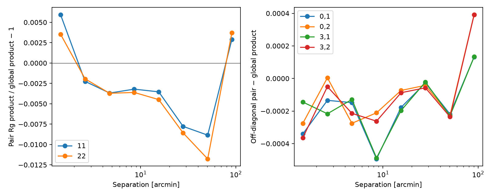

# DES case-d validation

These are observed results on Martin's four unblinded image-simulation grids.
Each grid contains five external-shear branches and 39 shared tile labels.
The injected shear is 0.025 from the existing manifest-derived m config; the metacal step is 0.01.
The measured code revision is recorded in each linked JSON file.

| Grid | Martin paired (m1, m2) | New paired (m1, m2) | New unpaired m1 | New unpaired m2 |
| --- | --- | --- | --- | --- |
| 1 | +0.003488, +0.010282 | +0.003488, +0.010282 | -0.011566 ± 0.009560 | -0.005699 ± 0.009517 |
| 2 | -0.011310, -0.003263 | -0.011310, -0.003263 | -0.020121 ± 0.007458 | -0.018895 ± 0.006948 |
| 3 | -0.010499, -0.001497 | -0.010499, -0.001497 | -0.025214 ± 0.006405 | -0.011697 ± 0.007920 |
| 4 | +0.002463, -0.000462 | +0.002463, -0.000462 | -0.015902 ± 0.006715 | -0.017761 ± 0.010664 |

The paired reproduction matches cuts (including FLAGS≤2), 20×20 table, right-closed interior cells, pair matching radius and symmetric pair weights.
Across all 20 external-shear products, max |R_new−R_Martin| = 7.04e-16, max relative W difference = 5.88e-15, and max paired-m difference = 4.22e-16.
The comparison uses `/n23data1/mkilbing/imsim_wdes_response/grid_*/des_d/results/m_bias_results.yaml`, specifically `weights.w_des`, not its unweighted top-level headline.

The unpaired estimator deliberately uses each external branch's full selected population, with its own weights and response.
Its errors delete the same tile on both external branches and recalibrate R for each deletion, conditional on the fixed W table.
These errors are not conditional fixed-response object-bootstrap errors.
The paired comparison remains diagnostic because matching changes the population without recalibrating its selection response.
Squaring IV errors changes exported w_iv but cannot change pure-DES W/R/m; IV proxies are not used.
No mean shear is subtracted from these constant-shear simulations.
These runs validate agreement with Martin's implementation, not a new fiducial residual-m calibration for blinded v2 data.


## Response distributions and spatial diagnostics


## Two-point response: stage 1 only

The pair diagnostic measures all 16 products of R_g elements with DES pair weights in eight coarse bins from 1–120 arcmin, using the no-external-shear simulation branch.
The map above uses the same sample's mean R_g across tiles.
The first panel shows the diagonal pair products relative to global weighted products; the second shows products involving off-diagonal elements minus their global products.
The two diagonal products are shown separately, without imposing isotropy.



| Grid | Wall time [s] | Peak RSS [MiB] | Max diagonal pair/global deviation |
| --- | --- | --- | --- |
| 1 | 41.5 | 1503 | 1.18% |
| 2 | 43.8 | 1587 | 0.53% |
| 3 | 51.5 | 1578 | 0.41% |
| 4 | 34.4 | 1288 | 0.68% |

Wall time/RSS include five calibrations, fixed-W tile covariance, plotting, scalar pair counting and matching on four allocated cores.
Per-branch timings are in [grid 1](grid_1.json), [grid 2](grid_2.json), [grid 3](grid_3.json), [grid 4](grid_4.json).
The original comprehensive catalogues are read in their existing locations; no catalogue is committed here.

**No total-response adequacy verdict is justified.**
The measured scale dependence is shear-only; selection/weight derivatives and a calibration budget agreed with Martin are still missing.
This implements stage 1 and leaves #23 open.
No Appendix-A mixed derivatives or blinded v2 signal were measured.

## Reproduction

On allocation 1037389, from this checkout:

```bash
TMPDIR=/n17data/cdaley/tmp MPLCONFIGDIR=/n17data/cdaley/tmp/mpl \
srun --jobid=1037389 -n 1 -c 4 apptainer exec --bind /automnt,/n17data,/n23data1 \
  --env PYTHONPATH=$PWD/src ~/.cache/sp_validation/sp_validation.sif \
  python scripts/validation/validate_response.py --grid 1 \
  --output /n17data/cdaley/scratch/response-pr/grid_1
```

Repeat for grids 2–4, then run `scripts/validation/summarize_response.py` on a compute node.
Fixed-W covariance is primary here; whether W should be refit in each spatial deletion remains a review question, not an implemented alternative.
